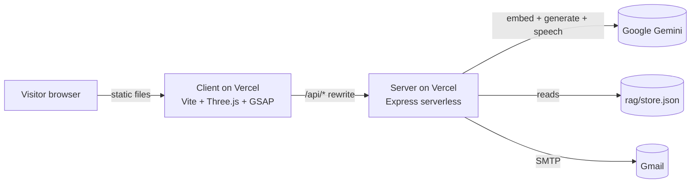

<div align="center">

# 🛰️ SIGNAL LOST

### An interactive, gamified 3D portfolio

**Restore power to an abandoned space station, talk to its AI, and meet the engineer behind it.**


Built by **Muhammad Ahmed** · BS Computer Science & IT, NED University of Engineering and Technology

</div>

---

## 📑 Contents

- [About the project](#-about-the-project)
- [Two ways to explore](#-two-ways-to-explore)
- [Gameplay](#-gameplay)
- [A.R.I.A, the station AI](#-aria-the-station-ai)
- [Contact form (Comms Tower)](#-contact-form-comms-tower)
- [Tech stack](#-tech-stack)
- [Architecture](#-architecture)
- [Local setup](#-local-setup)
- [Environment variables](#-environment-variables)
- [Scripts](#-scripts)
- [Controls](#-controls)
- [Adding your own media](#-adding-your-own-media)
- [Project structure](#-project-structure)
- [API](#-api)
- [Deployment](#-deployment)
- [Troubleshooting](#-troubleshooting)
- [Shared contracts](#-shared-contracts-for-developers)

---

## 🚀 About the project

**SIGNAL LOST** turns a portfolio into a short game. You are a Recovery Engineer who boards a dead space station. Each room you power on reveals a part of the portfolio owner's story: education, projects, skills and more. The station AI, **A.R.I.A**, is a Retrieval-Augmented Generation (RAG) chatbot that answers questions about Muhammad using only the facts in this repository's knowledge files.

Prefer a normal website? There is a scrolling **Quick Portfolio** too.

Visual style: dark sci-fi, cyan `#00E5FF`, warning orange `#FF6B2C`, background `#05070D`, fonts Orbitron and Share Tech Mono.

## 🎮 Two ways to explore

On the first screen the visitor chooses:

| Mode | What it is | Direct link |
| --- | --- | --- |
| **Play the mission** | The full game: 3D rooms, mini-games, XP, A.R.I.A | `/#play` |
| **Quick portfolio** | A normal scrolling page over a Three.js background, with a short intro video, A.R.I.A and the contact form | `/#quick` |

The Quick Portfolio lives in `client/src/portfolio/` and reads `data/profile.json`, `data/resume.json` and `data/projects.json`.

## 🕹️ Gameplay

**Goal:** bring the station to 100% power, trace the rogue signal and open the Comms Tower.

| Room | Portfolio content | Mini-game |
| --- | --- | --- |
| Crew Quarters | About, biography | **Codebreaker**: guess a 5-letter word in 6 tries |
| Engineering Bay | Projects | **Wires** puzzle |
| Reactor Core | Skills radar | **Oxygen stabilizer** |
| Archive | Education timeline | **Asteroid dodge** |
| Comms Tower | Contact form | Unlocked by the rogue-signal mission |

**Rules**

- **Power** = powered rooms ÷ 4. Winning a room's mini-game powers it.
- **XP and ranks:** Cadet 0 · Technician 100 · Engineer 250 · Commander 450 · Station Legend 700.
- **Oxygen** drains 1% every 6 seconds. Floating oxygen cells give +25%. At 0% oxygen you lose 20 XP and get an emergency 50% refill.
- **Game over:** if your XP runs out, a popup appears and you return to the ENTER STATION page for a fresh run.
- **100% power:** oxygen jumps to 100% and freezes, and XP no longer drops.
- **CV button:** disabled until the station is at 100% power.
- **Rogue signal (final mission):** at 100% power an alert opens. Ask A.R.I.A **one** question about Muhammad; once she finds the answer in her records the signal is traced and the Comms Tower unlocks. If A.R.I.A is offline, a manual trace button appears so the game never gets stuck.
- **Codebreaker:** 15 secret words across several categories (technology, space, animals, food, geography). Every round shows the **category**, a **clue** about what to find, and the **first letter**. A failed round costs 5 oxygen.
- **Sound** always starts on and is controlled only by the speaker icon in the top bar. The ambient hum grows louder as power returns.
- A hidden Easter egg unlocks a secret project.

## 🤖 A.R.I.A, the station AI

A terminal-style chat panel (`client/src/ui/chat.js`) used by both the game and the Quick Portfolio.

- **RAG pipeline:** knowledge files in `data/knowledge/*.md` are split into chunks, embedded with Gemini and stored in `server/rag/store.json`. Each question is embedded, the best chunks are found by cosine similarity, and Gemini answers **only** from them. If nothing scores above `RAG_MIN_SCORE`, A.R.I.A says there is no data and the LLM is not called.
- **Languages:** English, Urdu (script) and **Roman Urdu** (Urdu in English letters). She replies in the language of the question.
- **UI:** typewriter answers, a "processing" state, quick-question chips, a confidence meter, voice input (Web Speech API) and spoken answers.
- **Voice output:** English uses the browser voice. Urdu and Roman Urdu use Gemini text-to-speech through `POST /api/tts` (split into short pieces so speech starts quickly), with the browser voice as a fallback.
- **Gemini models:** the default is `gemini-3.5-flash-lite`. If a model is retired (404), overloaded (503) or times out, the server automatically tries `gemini-3.8-flash`, `gemini-3.6-flash` and `gemini-2.5-flash`. Set `GEMINI_MODEL` in `server/.env` to choose your first choice.
- **Achievements:** the chat counts questions (`chatterbox` after 5) and unlocks `linguist` for an Urdu or Roman Urdu question.

Open it with the **ASK A.R.I.A** button in the top bar, the `C` key, or the header button in the Quick Portfolio.

## 📡 Contact form (Comms Tower)

- **Frontend:** `client/src/ui/contactForm.js` (used by the Comms Tower room and the Quick Portfolio) and `client/src/rooms/beacon.js`.
- **Backend:** `server/routes/contact.js` → `POST /api/contact`.
- **Protection:** CORS limited to `CLIENT_URL`, 3 sends per 10 minutes per IP, hidden honeypot field `website`, a minimum time on the form (`X-Form-Opened` header), validation and escaping, an escaped HTML and plain-text email, and reply-to set to the visitor.

<details>
<summary><b>How to get a Gmail App Password (EMAIL_PASS)</b></summary>

1. Open https://myaccount.google.com and go to **Security**.
2. Turn on **2-Step Verification** (App Passwords only exist when it is on).
3. Open https://myaccount.google.com/apppasswords.
4. Type an app name, for example `SIGNAL LOST`, and click **Create**.
5. Google shows a 16-character password (like `abcd efgh ijkl mnop`). Copy it now; it is shown only once.
6. In `server/.env` set `EMAIL_USER=yourname@gmail.com`, `EMAIL_PASS=abcdefghijklmnop` (spaces are optional) and `EMAIL_TO=` the inbox that should receive messages.
7. Restart the server.

App Passwords are hidden for school or work accounts, accounts with Advanced Protection, and 2-Step Verification that uses only security keys. Use a normal personal Gmail account. **Never put your real Gmail password in `.env`, and never commit `.env`.**

</details>

<details>
<summary><b>Test the contact form</b></summary>

```bash
npm run test:contact        # sends 1 real email + a honeypot + 2 invalid attempts
```

curl (Mac, Linux, Git Bash):

```bash
curl -i -X POST http://localhost:5000/api/contact \
  -H "Content-Type: application/json" \
  -H "X-Form-Opened: $(( $(date +%s) * 1000 - 5000 ))" \
  -d '{"name":"Test User","email":"test@example.com","subject":"Curl test","message":"Hello from the terminal, this is a test message.","website":""}'
```

Windows PowerShell:

```powershell
$t = [DateTimeOffset]::UtcNow.ToUnixTimeMilliseconds() - 5000
Invoke-RestMethod -Method Post -Uri http://localhost:5000/api/contact -ContentType 'application/json' -Headers @{ 'X-Form-Opened' = "$t" } -Body '{"name":"Test User","email":"test@example.com","subject":"Curl test","message":"Hello from the terminal, this is a test message.","website":""}'
```

Success is `{"ok":true}` and a new email in the `EMAIL_TO` inbox.

</details>

## 🧰 Tech stack

| Layer | Technology |
| --- | --- |
| Client | Vite, vanilla JavaScript (ES modules), Three.js, GSAP |
| Server | Node.js, Express, helmet, cors, express-rate-limit, validator, nodemailer |
| AI | Google Gemini (chat, embeddings, text-to-speech) through the REST API, no SDK needed at runtime |
| Hosting | Vercel (client and server as two projects) or any Node host |

No React, no TypeScript, no extra frameworks.

## 🏗️ Architecture



## ⚙️ Local setup

**Requirements**

- Node.js **20.19 or newer** (Vite requirement). Check with `node -v`
- npm
- A Gemini API key: https://aistudio.google.com/app/apikey
- A Gmail App Password for the contact form (see above)

```bash
# 1. From the signal-lost/ folder, install everything
npm run setup

# 2. Create your env file
cp server/.env.example server/.env      # Windows: copy server\.env.example server\.env
# open server/.env and fill in GEMINI_API_KEY and EMAIL_USER / EMAIL_PASS / EMAIL_TO

# 3. Build A.R.I.A's memory (run again whenever data/knowledge/*.md changes)
npm run ingest

# 4. Run client and server together
npm run dev
```

- Client: http://localhost:5173
- Server: http://localhost:5000 (health check at http://localhost:5173/api/health)

## 🔐 Environment variables

Copy `server/.env.example` to `server/.env`. **Never commit `.env`** (it is in `.gitignore`).

| Variable | Required | Purpose |
| --- | :---: | --- |
| `GEMINI_API_KEY` | ✅ | Gemini API key |
| `GEMINI_MODEL` | | First-choice chat model (default `gemini-3.5-flash-lite`) |
| `GEMINI_TTS_MODEL` | | Text-to-speech model (default `gemini-2.5-flash-preview-tts`) |
| `GEMINI_EMBED_MODEL` | | Embedding model (default `gemini-embedding-001`) |
| `EMAIL_USER` | ✅ | Gmail address that sends the contact mail |
| `EMAIL_PASS` | ✅ | Gmail App Password (16 characters) |
| `EMAIL_TO` | ✅ | Inbox that receives the messages |
| `CLIENT_URL` | ✅ | The website's address; only this origin may call the API (comma-separate several) |
| `RAG_MIN_SCORE` | | Minimum retrieval score (default `0.35`) |
| `CHAT_RATE_PER_MIN` | | Chat requests per minute per IP (default `20`) |
| `TTS_RATE_PER_MIN` | | Speech requests per minute per IP (default `40`) |
| `CONTACT_RATE_LIMIT` | | Contact sends per 10 minutes per IP (default `3`) |
| `PORT` | | Local server port (default `5000`) |

## 📜 Scripts

Run from the `signal-lost/` folder.

| Command | What it does |
| --- | --- |
| `npm run setup` | Installs root, client and server dependencies |
| `npm run dev` | Runs client and server together |
| `npm run client` / `npm run server` | Client only / server only |
| `npm run ingest` | Builds `server/rag/store.json` from `data/knowledge/*.md` |
| `npm run test:rag` | Asks A.R.I.A a set of test questions and checks the answers |
| `npm run test:contact` | Tests the contact endpoint |
| `npm run build` | Production build of the client |
| `npm start` | Starts the server (with `NODE_ENV=production` it also serves `client/dist`) |

## ⌨️ Controls

| Input | Action |
| --- | --- |
| Mouse move | Camera parallax in the hub |
| Click a door | 1.2 s fly-through into that room |
| `Tab` / `Shift+Tab`, `Enter` | Keyboard navigation of doors and objects |
| `Esc` or **BACK TO HUB** | Return to the hub from any room |
| `C` or **ASK A.R.I.A** button | Open the A.R.I.A terminal (`Esc` closes it) |
| Speaker icon (top bar) | Mute or unmute sound |
| `D` | Print the game state to the browser console (debug) |

## 🎬 Adding your own media

| File | Where | Used for |
| --- | --- | --- |
| `Muhammad_Ahmed_Resume.pdf` | `client/public/cv/` | CV download and viewer |
| `intro.mp4` | `client/public/video/` | Intro video in the Quick Portfolio (Crew section) |
| `intro-poster.jpg` | `client/public/video/` | Poster image shown before the video plays |
| `avatar.fbx` | `client/public/models/` | 3D avatar in the Quick Portfolio hero (Mixamo FBX with a greeting animation) |

- The video is not downloaded until the visitor presses play. Use MP4 (H.264), about 720p and a few MB. Compress it with:
  ```bash
  ffmpeg -i source.mp4 -vf scale=-2:720 -c:v libx264 -crf 28 -preset slow -c:a aac -b:a 96k -movflags +faststart intro.mp4
  ffmpeg -i intro.mp4 -ss 2 -frames:v 1 -q:v 3 intro-poster.jpg
  ```
- If a file is missing, that part of the page simply does not appear and nothing breaks.
- The large FBX takes a few seconds to load. Converting it to a compressed GLB would make it much lighter.

## 🗂️ Project structure

```
signal-lost/
├── client/
│   ├── index.html, vite.config.js, vercel.json
│   ├── public/            cv/, video/, models/, audio/
│   └── src/
│       ├── core/          main, events, state, scene, loader, input, audio, progress
│       ├── rooms/         hub, about, projects, skills, education, beacon
│       ├── games/         wires, oxygen, asteroids, codebreaker
│       ├── ui/            hud, chat, modal, contactForm, achievements
│       ├── portfolio/     quick.js, quick.css, avatar.js   (Quick Portfolio)
│       └── styles/        main.css, chat.css, beacon.css
├── server/
│   ├── index.js           Express app (also exported for Vercel)
│   ├── api/index.js       Vercel serverless entry
│   ├── vercel.json
│   ├── routes/            chat, contact, tts, leaderboard
│   ├── rag/               gemini, ingest, retrieve, test, store.json
│   └── test-contact.js
└── data/                  profile, about, education, projects, skills, resume, achievements (.json)
                           knowledge/*.md   (A.R.I.A's source of truth)
```

### Main files

- `core/scene.js`: renderer, camera, bloom post-processing, resize, loop, adaptive quality
- `core/loader.js`: loading manager, GLTF and Draco loaders, textures clamped to 1024 px
- `core/input.js`: raycasting, hover, clicks, keyboard proxies and focus ring
- `core/audio.js`: procedural Web Audio (no audio files needed)
- `core/progress.js`: turns game events into saved XP, power and achievements
- `ui/hud.js`: top bar, rank-up banner, oxygen and cells, XP-depleted game over, rogue-signal mission
- `rooms/*.js` and `games/*.js`: the six rooms and four mini-games

The Draco decoder is copied to `client/public/draco` automatically by `npm install` and `npm run dev`.

## 🔌 API

| Method | Route | Body | Returns |
| --- | --- | --- | --- |
| `POST` | `/api/chat` | `{ message, lang: 'en' \| 'ur' }` | `{ answer, found, sources: [{ id, title, snippet, score }] }` |
| `POST` | `/api/tts` | `{ text }` | `audio/wav` (Urdu and Roman Urdu speech) |
| `POST` | `/api/contact` | `{ name, email, subject, message, website }` | `{ ok, error? }` (`website` is a honeypot and must stay empty) |
| `GET` | `/api/health` | | `{ ok: true }` |
| `GET` / `POST` | `/api/leaderboard` | `{ name, xp, achievements? }` | `{ ok, entries }` (not used by the current UI; scores are not saved on Vercel) |

Roman Urdu is detected on the server, so the chat contract stays `lang: 'en' | 'ur'`.

## ☁️ Deployment

### Option A: Vercel, two projects (recommended)

Both projects come from the **same GitHub repository**. Every `git push` redeploys them automatically.

**1. Backend project**

| Setting | Value |
| --- | --- |
| Root Directory | `server` |
| Framework Preset | `Other` |
| Environment Variables | `GEMINI_API_KEY`, `GEMINI_MODEL`, `EMAIL_USER`, `EMAIL_PASS`, `EMAIL_TO`, `CLIENT_URL` |

- `server/rag/store.json` must be committed (run `npm run ingest` before pushing).
- `server/api/index.js` and `server/vercel.json` turn the Express app into a serverless function.
- Check it at `https://<backend>.vercel.app/api/health`.

**2. Frontend project**

1. In `client/vercel.json`, set the rewrite destination to your backend URL:
   ```json
   {
     "rewrites": [
       { "source": "/api/:path*", "destination": "https://<backend>.vercel.app/api/:path*" }
     ]
   }
   ```
2. Create a second Vercel project from the same repo with Root Directory `client` and the `Vite` preset.
3. Keep **"Include source files outside of the Root Directory in the Build Step"** turned **on**: the client imports files from the top-level `data/` folder.

**3. Finish**

Set the backend's `CLIENT_URL` to the frontend's real address (no trailing `/`) and **redeploy the backend**. Environment variable changes only apply after a redeploy.

### Option B: one Node server

```bash
npm run build
NODE_ENV=production npm start      # serves the API and the built client from one origin
```

Set the variables from `server/.env.example` on your host.

## 🛠️ Troubleshooting

<details>
<summary><b>A.R.I.A says "language core is busy" or times out</b></summary>

Google's model may be overloaded or retired. The server already falls back to other models. Check the server log for lines starting with `[gemini]`, and set `GEMINI_MODEL=gemini-3.5-flash-lite` in `server/.env`.

</details>

<details>
<summary><b>A.R.I.A says there is no data for everything</b></summary>

`server/rag/store.json` is missing or empty. Run `npm run ingest`, and commit the file if you deploy to Vercel.

</details>

<details>
<summary><b>Urdu or Roman Urdu answers are not spoken</b></summary>

Turn **VOICE** on in the terminal. The server needs `GEMINI_API_KEY`; if `/api/tts` fails, check `GEMINI_TTS_MODEL` and the free-tier quota.

</details>

<details>
<summary><b>Contact form fails</b></summary>

Use a Gmail **App Password**, not your normal password, and check `CLIENT_URL` matches the site's address.

</details>

<details>
<summary><b>Intro video or avatar does not show</b></summary>

Check the file names and folder (`client/public/video/intro.mp4`, `intro-poster.jpg`, `client/public/models/avatar.fbx`). Missing files are skipped silently; the browser console shows `[avatar] not shown` for the avatar.

</details>

<details>
<summary><b>Vercel build fails or <code>/api</code> returns a login page</b></summary>

- Build fails on imports from `data/`: turn on "Include source files outside of the Root Directory".
- Login page: Vercel project **Settings → Deployment Protection → Vercel Authentication → Disabled**.
- Look in the backend project's **Logs** tab for the real error.

</details>

<details>
<summary><b>Other</b></summary>

- **Blank screen or WebGL error:** enable hardware acceleration or try another browser.
- **Port already in use:** change `PORT` in `server/.env` and the proxy target in `client/vite.config.js`.

</details>

## 📐 Shared contracts (for developers)

- **Event bus** (`src/core/events.js`): `emit`, `on`, `off`. Events: `room:enter`, `room:power`, `xp:add`, `achievement:unlock`, `game:win`, `game:lose`, `chat:answer`, `avatar:talk`.
- **Game state** (`src/core/state.js`): `getState()`, `update(partial)`, `reset()`, saved in localStorage key `signal-lost-save`.
- **Rooms**: each exports `{ init(scene, ctx), enter(), exit(), update(dt) }`. Everything built in `enter()` is disposed in `exit()`.
- **Performance and accessibility:** pixel ratio capped at 2, textures max 1024 px, geometries and materials disposed on room exit, and `prefers-reduced-motion` is respected.

---

<div align="center">

Made by **Muhammad Ahmed** · Karachi, Pakistan

</div>
